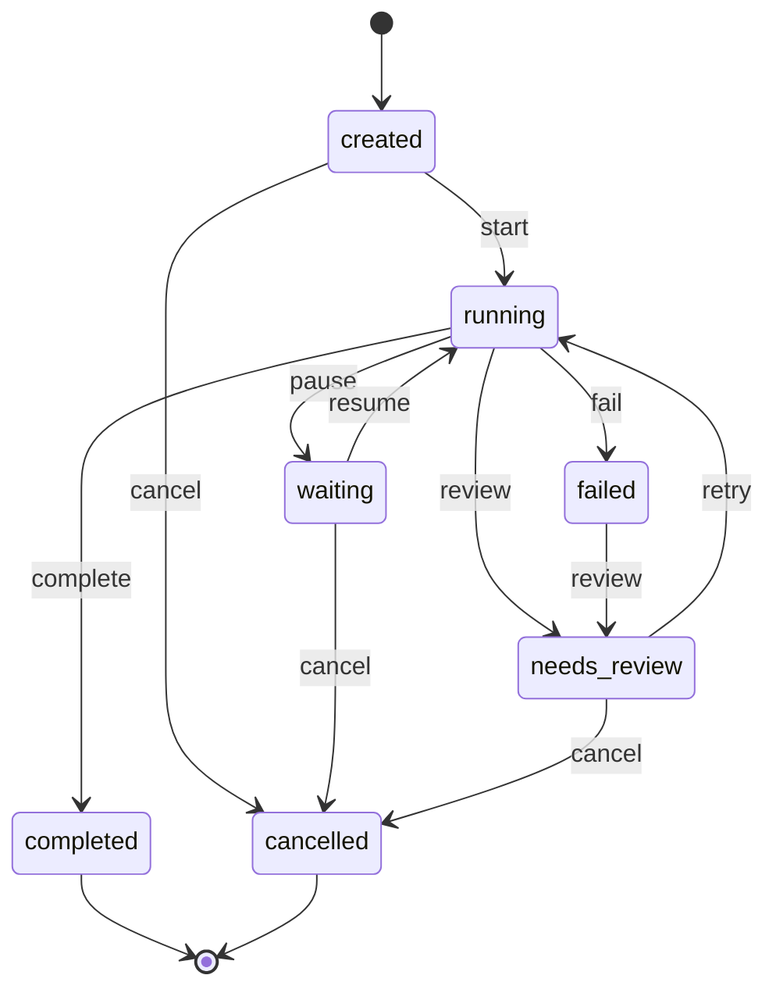

# Workflow State Transition Diagram

## State Descriptions

| State | Description |
|---|---|
| created | Workflow has been initialized |
| running | Workflow execution is active |
| waiting | Workflow is paused pending an event or approval |
| completed | All required workflow work has completed |
| failed | Workflow execution has failed |
| needs_review | Operator review is required |
| cancelled | Workflow execution has been cancelled |

Transitions are validated against `LEGAL_TRANSITIONS` in the source module.
